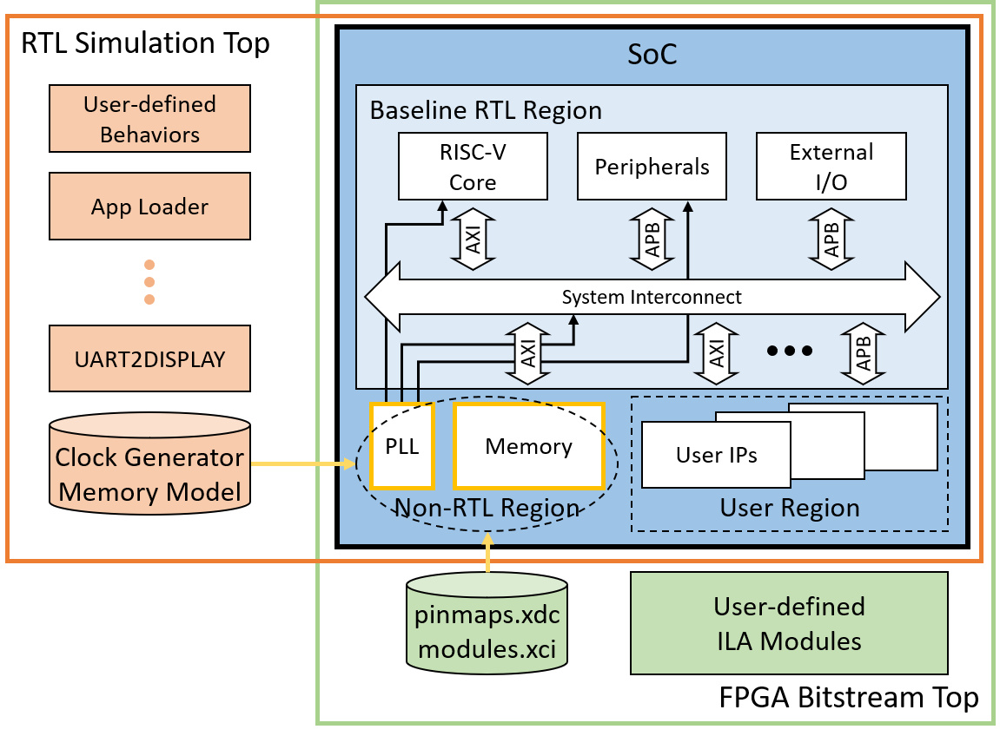
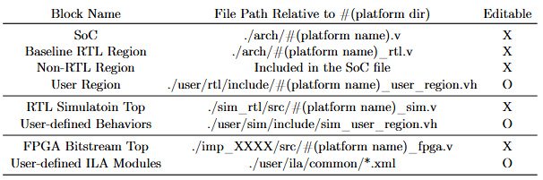

# NPX Manual: Understanding HDL Code Structure

## Overview

- This manual helps you understand the structure of the HDL code generated and used by the NPX tool.

## Block Hierarchy

## File Mapping

