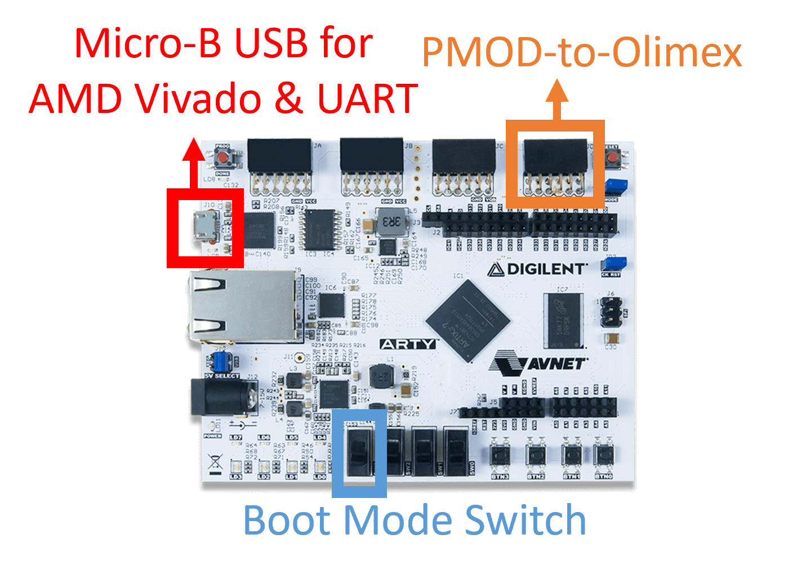
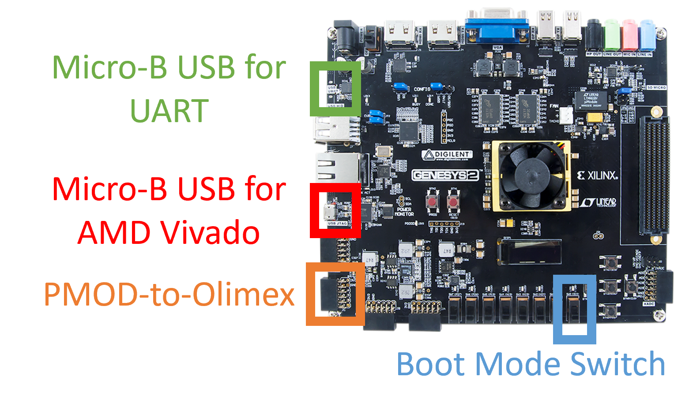
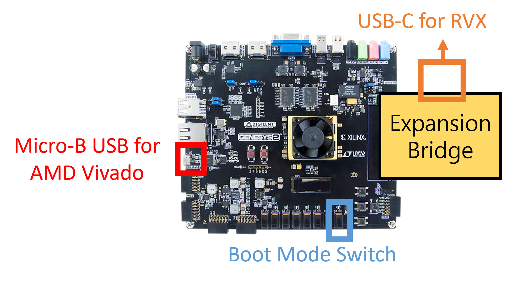
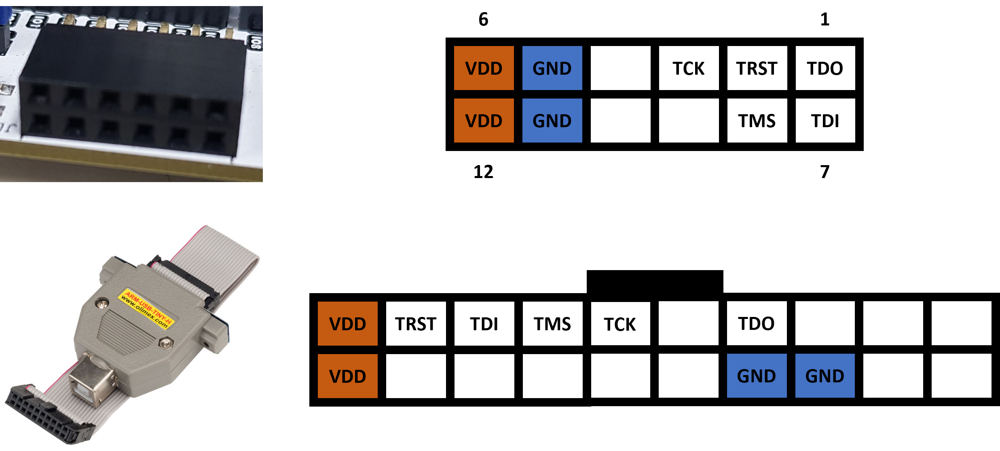

# NPX FPGA Setup Manual

## Overview

- This manual provides information about the supported FPGA boards and explains how to connect them to your computer for use with NPX.

- FPGA prototypes generated by NPX require additional module to connect to your computer, which varies by board.

- The additional module is either [Olimex ARM-USB-TINY-H](https://www.olimex.com/Products/ARM/JTAG/ARM-USB-TINY-H/) (OLIMEX-JTAG) or NPX Expansion Bridge (RVX-EB).

- RVX-EB is not an off-the-shelf product and is available by custom order only.

## Arty A7-100T + OLIMEX-JTAG

### Information

- This board is referred to as `arty-100t` in the NPX

- <https://digilent.com/shop/arty-a7-100t-artix-7-fpga-development-board/>

- <https://www.olimex.com/Products/ARM/JTAG/ARM-USB-TINY-H/>

- Vivado freely supports this board.

- Vivado 2022.1 or later is required.

- Installation of `Olimex Driver` and `Telnet` is required (See Miscellaneous section).

### Connection to your computer

- Micro-B USB port should be connected to your computer for FPGA programming and UART communication.

- PMOD port should be connected to your computer for NPX JTAG communication via the Olimex module (See Miscellaneous section).

- Make sure all the sliding switches are set to the down position.

## Genesys2 + OLIMEX-JTAG

### Information

- This board is referred to as `genesys2` in the NPX

- <https://digilent.com/reference/programmable-logic/genesys-2/>

- <https://www.olimex.com/Products/ARM/JTAG/ARM-USB-TINY-H/>

- A valid license for Vivado is required.

- A one-year temporary Vivado license is included with the board purchase.

- Vivado 2022.1 or later is required.

- Installation of `Olimex Driver` and `Telnet` is required (See Miscellaneous section).

### Connection to your computer

- Micro-B USB port should be connected to your computer for FPGA programming.

- Another Micro-B USB port should be connected to your computer for UART communication.

- PMOD port should be connected to your computer for NPX JTAG communication via the Olimex module (See Miscellaneous section).

- Make sure all the sliding switches are set to the down position.

## Genesys2 + RVX-EB

### Information

- This expanded board is referred to as `genesys2-eb` in the NPX

- [https://digilent.com/reference/programmable-logic/genesys-2/](https://digilent.com/reference/programmable-logic/genesys-2/)

- A valid license for Vivado is required.

- A one-year temporary Vivado license is included with the board purchase.

- Vivado 2022.1 or later is required.

- Installation of `RVX-EB` Driver and `Telnet` is required (See Miscellaneous section).

### Connection to your computer

- Micro-B USB port should be connected to your computer for FPGA programming.

- USB-C port should be connected to your computer for NPX functionality.

- Make sure all the sliding switches are set to the down position.

## AMD FPGA Board + RVX-EB

### Information

- Only AMD boards with an FMC connector are supported.

- An FPGA registration process is required (`imp_class_info`).

- The Vivado license depends on the FPGA chip you are using.

- Installation of `RVX-EB` Driver and `Telnet` is required (See Miscellaneous section).

### FMC Signal Mapping for a Pimmap of FPGA

| Signal | FMC Pin |
| :---: | :---: |
| pjtag_rtdo | LA_30P |
| pjtag_rtrstnn | LA_24N |
| pjtag_rtck | LA_30N |
| pjtag_rtdi | LA_28P |
| pjtag_rtms | LA_28N |
| printf_tx | LA_32N |
| printf_rx | LA_32P |
| PMOD1_1 | LA11_N |
| PMOD1_2 | LA11_P |
| PMOD1_3 | LA07_N |
| PMOD1_4 | LA07_P |
| PMOD1_7 | LA04_N |
| PMOD1_8 | LA04_P |
| PMOD1_9 | LA02_N |
| PMOD1_10 | LA02_P |
| PMOD2_1 | LA25_N |
| PMOD2_2 | LA25_P |
| PMOD2_3 | LA22_N |
| PMOD2_4 | LA22_P |
| PMOD2_7 | LA20_N |
| PMOD2_8 | LA20_P |
| PMOD2_9 | LA16_N |
| PMOD2_10 | LA16_P |

## Miscellaneous

### PMOD-to-Olimex Signal Mapping

Connect the five labeled signals using wires according to the mapping below.

### Olimex Driver

#### Instruction

=== "Windows"

    Connect the OLIMEX-JTAG cable to your computer.

    Run the zadig program

    > Run 'zadig-2.5.exe' from the ${RVX_RELEASE_HOME}\ windows_binary directory.  
    > Or, Download it from 'https://zadig.akeo.ie' and run it.

    In the zadig program,

    > Select [Olimex OpenOCD JTAG ARM-USB-TINY-H (Interface 0)].  
    > Click [Install Driver].  
    > Select [Olimex OpenOCD JTAG ARM-USB-TINY-H (Interface 1)].  
    > Click [Install Driver].

=== "Linux"

    No additional installation is required.

### RVX-EB Driver

#### Instruction

=== "Windows"

    Connect the RVX-EB cable to your computer.

    Run the zadig program

    > Run 'zadig-2.5.exe' from the ${RVX_RELEASE_HOME}\ windows_binary directory.  
    > Or, Download it from 'https://zadig.akeo.ie' and run it.

    In the zadig program,

    > Click [Options] in the menu bar.  
    > Click [List All Devices] by enable it.  
    > Select [Quad RS232-HS (Interface 0)].  
    > Select [WinUSB (XXXXXX)].  
    > Click [Install Driver] or [Replace Driver].

=== "Linux"

    No additional installation is required.

### Telnet

#### Instruction

=== "Windows"

    Open [Control Panel]

    > e.g., type 'control' into the Windows Search bar.

    Click [Programs]

    Click [Turn Windows features on or off]

    Enable [Telnet Client]

    Confirm

=== "Linux"

    No additional installation is required.

### FTDI Drivers for Telnet

If you use only Telnet on Windows without installing Vivado,  
you need to install the FTDI driver.

#### Instruction

=== "Windows"

    Install the VCP drivers from <https://ftdichip.com/drivers>.

=== "Linux"

    No additional installation is required.
